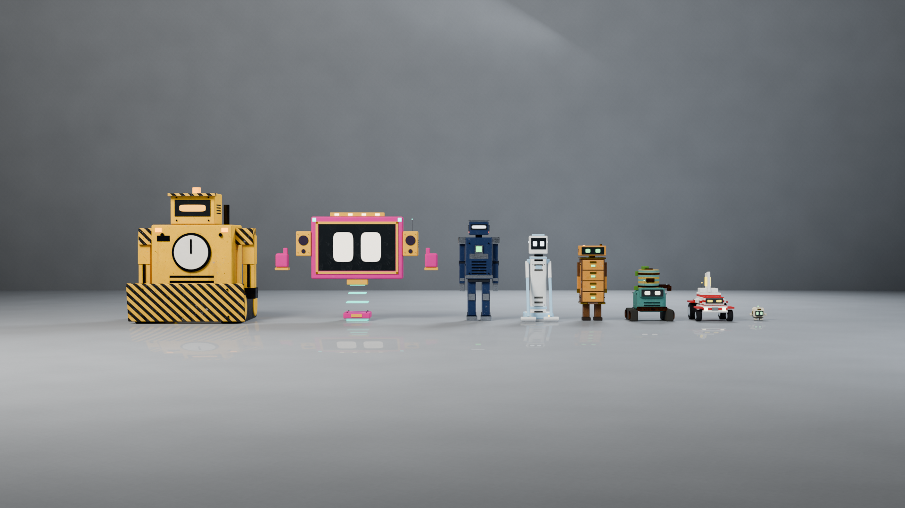

# The Tiny Robot

**An open movie project by [Thinkelution](https://thinkelution.com).** Website: [thetinyrobot.online](https://thetinyrobot.online)

> In a world of robots, each programmed with one logic, there is a tiny old robot: just a head, two small hands and
> two small feet. Its one logic: *"Do things, but do not cause harm to anyone or hurt anyone knowingly."*
> It also knows that trees and plants are living things, so it won't hurt them either.



## The experiment

Can a small team make a studio-quality animated short film with **Blender + Claude**, with no manual modelling,
texturing or animation, on a budget closer to a $100 Claude plan than a studio's? We don't know yet. Worth a shot.

Everything is in this repository: the pipeline code, every prompt, the generated script, the robot designs, the
texture library and the renders, plus a production diary with what each step cost and what went wrong
([docs/PROCESS.md](docs/PROCESS.md)).

## Where we are

| Stage | Status |
|---|---|
| Script (33 min, 31 scenes, 3 acts) | Done: [script.md](films/the-tiny-robot/script.md) |
| Robot characters (8, with their logics) | Done: [cast.md](films/the-tiny-robot/cast.md) |
| Studio texture library | Done: [textures/](textures/) |
| Teaser reel (40.9 s, 16:9 + 9:16) | Done: [watch on thetinyrobot.online](https://thetinyrobot.online/#teaser) |
| World: Gridhaven and all 8 sets | Done: [city plan](films/the-tiny-robot/world/plan.md), [look-dev frames](films/the-tiny-robot/world/lookdev/) |
| Shots, animation, voices, music | Next |
| Final film | Later |

## The cast

| Robot | Logic |
|---|---|
| The Tiny Robot | "Do things, but do not cause harm to anyone or hurt anyone knowingly." |
| Foreman Quota | "Finish every job faster than yesterday." |
| Mossback | "Never stop." |
| Ledger | "Count everything and remember it." |
| Shine | "Make the crowd happy." |
| Warden Plumb | "Obey the Board's orders exactly." |
| Dash | "Always win." |
| Primly | "Keep everything clean and in its place." |

## How it works

```
brief.md (the owner's words)
  └─ agent/story.py   Claude: bible -> outline -> every scene -> script editor review -> script.md
  └─ agent/cast.py    Claude: each robot as a parts list -> Blender builds + renders it -> Claude checks the
                      renders and fixes the spec
  └─ textures/        FLUX.2 klein 4B (Apache-2.0) generates surface photos -> build.py makes them seamless
                      PBR maps (colour, height, normal)
  └─ blender/         robot builder, layered texture materials, studio turnaround renderer (Cycles)
```

- **Claude** writes and reviews: story, dialogue, character design specs, render reviews. Model: Claude Opus 5.5
  through the API (`agent/llm.py`), or Claude Code itself when working in a session.
- **Blender 5.3** builds and renders everything from JSON by script. Nothing is modelled by hand.
- Robots are simple boxes on purpose; the studio look comes from bevels, PBR texture sets, edge wear, grime and
  lighting.

### Run it
```
python agent/story.py films/the-tiny-robot all       # needs an Anthropic API key
python agent/cast.py  films/the-tiny-robot all       # needs Blender 5.3
python textures/build.py                             # rebuild the texture maps from textures/raw
blender -b --factory-startup -P blender/turnaround.py -- <out dir> films/the-tiny-robot/cast/tiny.json
```
`agent/llm.py` reads the key from a local keys file; point `KEYS` at your own, or adapt it to an environment
variable. Rendering uses Cycles on any GPU Blender supports (we use an AMD RX 7600 through HIP).

### Builder conventions
Z up, robots face -Y, a robot's left is +X. Parts are bevelled boxes with box UVs at 1 UV unit = 1 m. Every part has
a joint empty `<id>:<part>` with a `role` the animator drives. Eyes are emissive meshes with shape keys (blink,
happy, sad, angry, wide, squint). Optional spec fields: `rest_rot` (resting joint rotation) and `face.rest`
(resting expression).

## Licence
- Code (`agent/`, `blender/`, `textures/*.py`): [MIT](LICENSE)
- Film content (script, story files, robot designs, textures, renders): [CC BY 4.0](LICENSE-CONTENT.md).
  Use it, remix it, credit "The Tiny Robot, an open movie project by Thinkelution".
