# The Tiny Robot: cast

Shader (Cycles) studio renders. Designed by Claude from the bible, then reviewed and fixed by Claude in session (2026-11-14): Tiny got mitten hands and dark face glass, Dash became a stepped wedge, Primly pushes floor brooms, Shine got huge eyes, visors fit their heads.

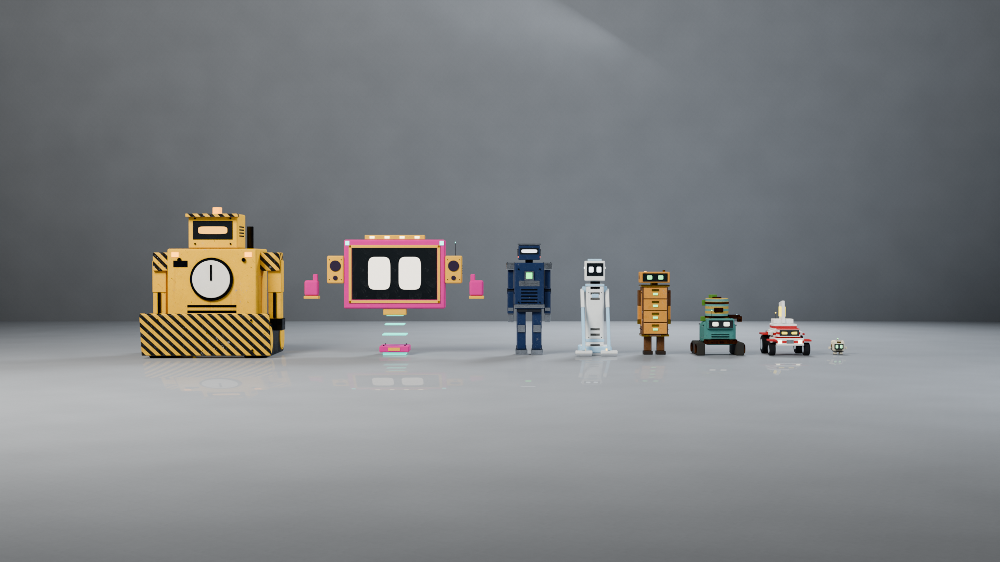

## The Tiny Robot  ·  Protagonist

**Logic:** "Do things, but do not cause harm to anyone or hurt anyone knowingly. It also knows that trees and plants are living things, so it will not hurt them either, willingly."

**In practice:** Before every action Tiny pauses, its eyes sweep left and right, and it murmurs 'Check... no harm. Go.' Then it acts. It steps around a weed growing in a pavement crack. It carries crates one at a time so nothing topples. It carries seeds back that Primly has swept away. It will stand in front of a sapling and refuse to move, because once it knows what will happen, stepping aside would be helping. Its logic does not say 'tell the truth'. Tiny discovers that a lie, once it knows the facts, is just another way of hurting someone.

**Weak spot:** Its logic only covers harm it knows about. It cannot see behind walls, and it has never thought about what it doesn't know. When it pulls a lever to water the thirsty rooftop seedlings, it checks, sees no harm and goes. It has no idea that the same lever cuts water to the Old Grove. It is also so careful that it can freeze completely when every choice seems to hurt someone.

**Arc:** Tiny starts out cheerful, slow and certain that being careful means being harmless. When it learns that it caused the Grove's drought, and that its friend Mossback is being blamed, its logic locks: undoing the lever would kill the seedlings, and leaving it kills the trees. Shine offers an easy lie, which is to blame Dash. Tiny works out that silence would hurt Mossback, the lie would hurt Dash, and both would be harm done knowingly. It climbs onto the Big Board stage and tells the truth, knowing it will be re-pressed for it. Then it finds a third option, a second pipe, and builds it using every other robot's logic where that logic does good. By the end Tiny has learned that a mistake doesn't make it harmful. Hiding the mistake would have.

**Voice:** Small, warm and slightly crackly, like an old speaker that was well made. Mid-high pitch, gentle, with a soft electronic chirp at the end of happy sentences.

**Build:** 0.35 m tall, walk, 22 parts, 4 materials. Tiny is one bread-bin cube of a head with floating block hands and flat square feet, so in silhouette it is the smallest, simplest shape in Gridhaven: a little box on little feet with a single glowing square on top. Everything is squared-off and deliberate like the city, but the heavy rounding, soft gaps and oversized face screen make it read as gentle and harmless, and its small careful hands and wide flat feet say it moves slowly and steps where it means to. The big two-eye screen does all the acting, sweeping left and right for its 'Check... no harm. Go.', while the cube antenna tip shifts from soft green certainty to amber checking. Faded, scuffed cream paint wearing to metal and a dull brass First Workshop stamp, ear discs and carry handle make it feel old, well made and once owned and loved, a warm note against the cool steel blue and safety yellow city and a natural friend to the greens and browns of the Old Grove.

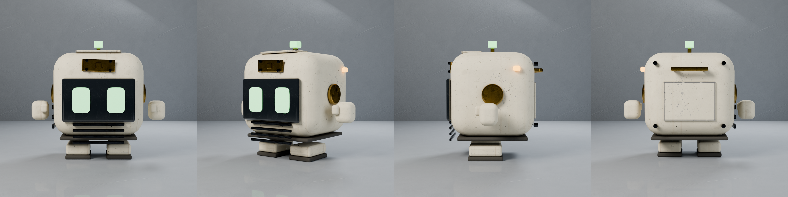

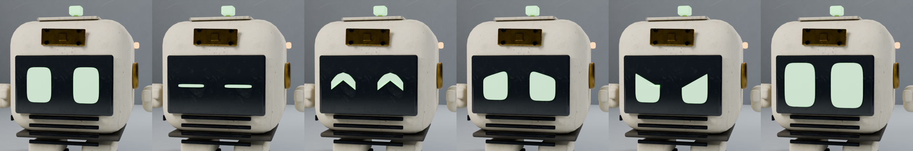

## Foreman Quota  ·  Antagonist-by-logic

**Logic:** "Finish every job faster than yesterday."

**In practice:** Quota's chest dial is always counting. It builds the fastest roads, towers and bridges in Gridhaven and is honestly proud of how much it has improved the city. It sees the Old Grove as the one bend that makes the Fast Lane slow. When the Grove starts wilting, Quota calls it 'already finished' and pushes the Board to vote for clearing.

**Weak spot:** Quota measures time, not what is lost. Anything that cannot be timed, such as a tree, a friendship or a second chance, looks to it like delay. It isn't cruel. It simply cannot see what isn't on its dial.

**Arc:** Quota starts as the force bearing down on the Grove. After the vote it gives Tiny one night: if the water is back by sunrise, the Grove stays. Tiny challenges it to lay a new pipe faster than anything Quota has ever done, and Quota can't resist. Through the rainy night its logic works for the Grove instead of against it. At the last gap, where a root blocks the straight line, Quota wants to cut through. Tiny stands in front of the root and refuses to move. Quota locks, then finds the faster answer: bend the pipe over the root. At sunrise its dial shows a new record. Quota quietly re-routes the Fast Lane around the Grove and announces that 'around is faster than arguing.'

**Voice:** Deep, rumbling, engine-like. Low pitch, with a diesel growl under the words and a clicking stopwatch sound between sentences.

**Build:** 3.2 m tall, treads, 29 parts, 5 materials. Quota reads as a low, wide wall: a 2.7 m hazard-striped blade out front, a broad slab body planted between two heavy treads, and a squat cab head that barely rises above its shoulders, so in silhouette it is pure forward pressure. Every shape is a straight line or a right angle, rigid piston-bar arms, a flat tilted blade, a single long horizontal eye-slit, because Quota's logic only knows the shortest path from here to done. The one circle on its body is the white stopwatch dial set dead-centre in its chest, making time literally the heart of the machine and the first thing the audience reads. Safety yellow paint worn to dark steel at the edges says it has worked hard and proudly for years, the black hazard stripes on blade, visor and shoulders mark it as a danger to anything in its way, and the amber eye and roof beacon tie it to the pulsing warning lights of the Pipeworks until those same ambers warm into the gold sunrise over the Grove.

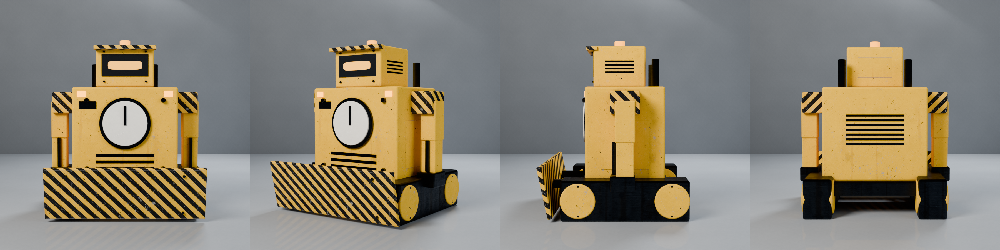

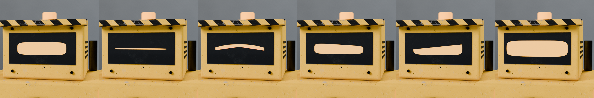

## Mossback  ·  Tiny's best friend

**Logic:** "Never stop."

**In practice:** Mossback rolls the same loop around the Grove day and night, tipping a slow measure from its tank at each tree. Because it never stops, the trees have never missed a drink, until the main line goes dry. Moss has started growing on its back: small green cube clusters that sway as it moves.

**Weak spot:** It can't stop to explain itself, help in an emergency, or defend itself when it is blamed. Every conversation with Mossback happens in pieces as it rolls away and comes back around.

**Arc:** Mossback is wrongly blamed for the Grove's drought and taken to a holding pen at the Foundry. There it keeps looping in a sad little square, still unable to stop. When Tiny's confession frees it, Mossback's never-stopping becomes the plan's backbone: all night it ferries water tanks from the Rooftop Nursery to the thirstiest trees, keeping them alive until the new pipe is finished. At the end its loop is a little wider and now includes Tiny's crate in the Junk Stacks.

**Voice:** Slow, warm and gravelly, like a kind old engine. Its voice fades as it rolls away and swells as it comes back, which the sound mix should play up.

**Build:** 1.3 m tall, treads, 24 parts, 5 materials. Mossback reads as a low, stout box on two long treads with a fat upright drum on its back and a fringe of green cubes breaking its outline, so even in fog its silhouette is a slow, heavy pack animal. Everything is long, low and continuous: the treads run the full body length with no sharp front or back, the head sits forward and low like a tortoise, and the square spout juts sideways toward the trees on its loop, because this machine is built to keep moving and pour without ever turning to face anything. It has no arms, which is its blind spot made literal: it cannot stop, reach or defend itself, it can only carry and roll on. Weathered teal paint worn through to rust-brown straps and bare metal tells decades of rain, a faded safety-yellow stripe on the tank ties it back to Gridhaven's city order, and the moss green cubes show the Grove slowly claiming it. Soft white oval eyes in a wide low screen give it the tired, kind gaze of an old engine, with small amber tail lights that the camera sees as it rolls away mid-sentence.

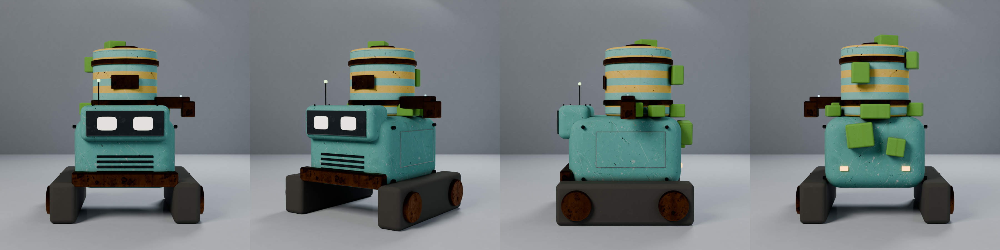

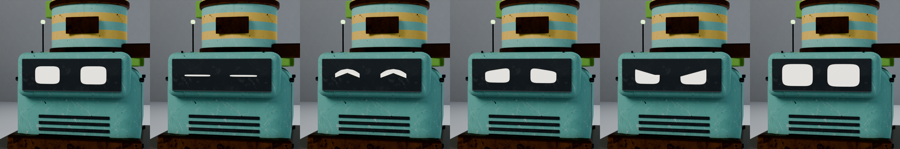

## Ledger  ·  Keeper of the Count House

**Logic:** "Count everything and remember it."

**In practice:** Ledger records every gauge reading, footstep, vote and water flow in Gridhaven, and stores them in glowing data blocks on its shelves. When asked, it can tell you exactly when the Grove's water dropped, to the minute, and how many feet passed the Pipeworks lever at that moment. One small pair.

**Weak spot:** Ledger counts but never judges. It will not volunteer what a number means, and it never thinks to speak up. It has known the truth about the drought from the start and said nothing, because no one asked the right question.

**Arc:** Ledger begins as a dry source of facts that Tiny has to coax meaning out of. After watching Tiny confess, Ledger chooses for the first time to put a number in front of a crowd: it projects the flow records onto the Big Board, proving the Grove was thirsty, not dying. Later it calculates the route for the second pipe. In the final scene it adds a new category to its records, 'times a robot told the truth when it cost it', and logs the first entry.

**Voice:** Dry, even, mid-low pitch, with soft paper-shuffle clicks and a little bell ding when it finds a record.

**Build:** 1.8 m tall, walk, 26 parts, 5 materials. Ledger reads as a tall, narrow filing cabinet topped by a wide flat lid of a head, the only vertical rectangle in the cast that has no curves at all. Its body is literally its memory: four evenly spaced amber drawers, each with a brass label plate and a lit green square handle, stacked like rows in a ledger, while short block legs and rigid straight arms make every movement look deliberate and counted. The wide head is a counter display where green eye shapes sit between digits, and a tiny brass bell on top dings when a record is found, with a rubber roller on its back for gliding along the archive's ladder rail. The colour story is warm walnut casing, worn amber drawer fronts and brass fittings, so it feels like an old library inside the cold steel city, and the soft green glow of its handles and digits ties it to data and to the Grove it quietly remembers.

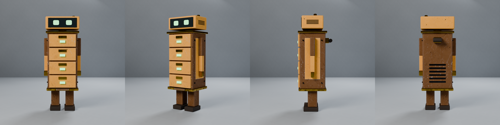

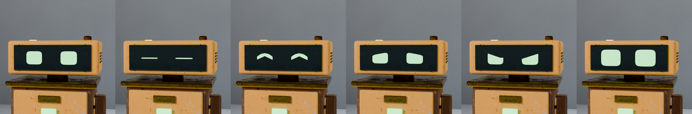

## Shine  ·  The host of the Big Board and the city's favourite entertainer

**Logic:** "Make the crowd happy."

**In practice:** Shine runs the votes at Main Square, cheers up tired workers, and turns every announcement into a show. At its best it brings the whole city together. At its worst it gives the crowd whatever makes them cheer fastest: a villain, a hero, a simple story. It points at Mossback as the culprit because the crowd wants someone to blame, and it urges Tiny to blame Dash because a hero story would get a huge cheer.

**Weak spot:** Shine confuses cheering with being happy. It has never seen a crowd go quiet because it was moved, and it doesn't know that a hard truth can make a crowd happier in the long run than a pleasant lie.

**Arc:** Shine offers Tiny the easy lie, sincerely, as a kindness. When Tiny tells the truth on stage, the crowd goes silent and Shine locks, screen flickering, because silence reads as failure to its logic. Then the crowd's chest lamps start glowing green one by one, quietly, and Shine sees a happiness it has never measured. It unlocks, and in the final vote it asks the crowd the honest question instead of the exciting one.

**Voice:** Bright, big, game-show-host energy. Mid-high pitch, with a sparkle sound effect at the end of lines. Its tone mirrors the crowd's mood instantly.

**Build:** 2.6 m tall, hover, 24 parts, 5 materials. Shine reads in silhouette as a wide floating billboard: a 2.2 m magenta screen frame flanked by gold speaker cubes, crowned by a bulb-lit marquee, with two big detached block hands hovering out at the sides for wild game-show gestures. Everything about the shape faces outward to an audience: the giant screen is the face, the speakers broadcast, and the gold trim around the screen frames it like a stage. The body is held up by nothing but a stack of teal hover rings over a small glowing pad, so its whole existence visibly floats on the crowd's attention. The magenta and gold showbiz palette pops hard against Gridhaven's steel blue and concrete grey. Its bright white screen glow makes it the warmest light in Main Square, while the teal under-glow ties it to the city's signal lamps.

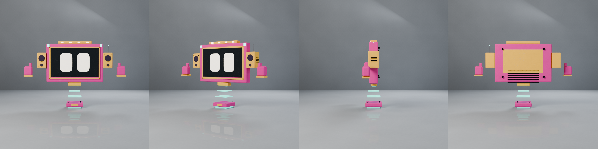

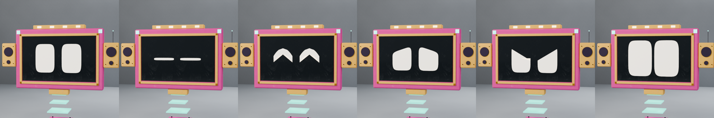

## Warden Plumb  ·  The city's enforcer

**Logic:** "Obey the Board's orders exactly."

**In practice:** Warden carries out every decision from the Big Board to the letter, without favour or anger, which makes it reliable and fair. It also does exactly what the words say and nothing more, and that leaves loopholes. Ordered to 'hold the culprit until sunrise', Warden agrees that nothing in the order says where. So it carries Tiny in a crate to the Pipeworks, where Tiny directs the night's work.

**Weak spot:** Warden never asks whether an order is right, only what it says. It would carry out an unjust order just as carefully as a just one.

**Arc:** Warden begins as a stern, faceless arm of the Board, marching Mossback away. Tiny keeps talking to it as a person, asking honest questions, and Warden starts reading its orders more carefully, then more kindly. Through the 'where' loophole it becomes a quiet helper. At the end, when the Board votes to let Tiny keep its logic, Warden carries out that order with the faintest smile its eye bar can make.

**Voice:** Flat, measured, low-mid pitch with a slight metallic echo, like an announcement in a big hall.

**Build:** 2.4 m tall, walk, 28 parts, 4 materials. Warden reads as a 2.4 m upright post: a tall unbroken navy pillar body, square silver shoulder caps and a flat-topped helmet box, with long rigid two-segment arms hanging straight to mid-thigh, so its silhouette is a sign-post rather than a figure. Every shape is a right angle and every joint lines up on a straight vertical axis, expressing a mind that follows the literal text of an order and nothing beside it; the single horizontal visor bar is a ruled line that can only tilt or thin, which makes its final faint smile land. Its heavy square feet and evenly spaced knee plates set up its measured, arriving walk. The colour story is the uniform of Gridhaven authority: deep navy paint with polished silver trim that echoes the city's steel blue, a cold white visor, and a square chest badge lamp that is the only place the Board's verdict shows, switching between green and red.

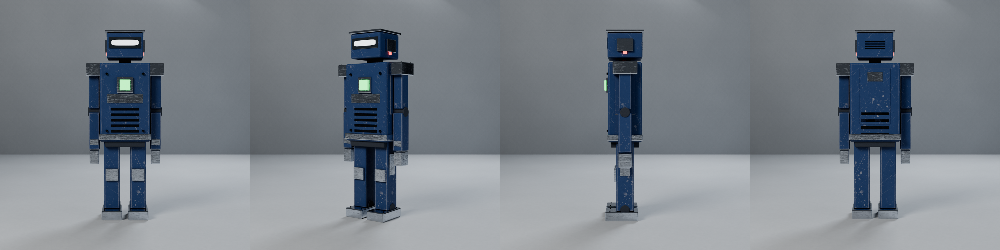

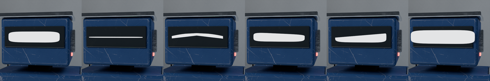

## Dash  ·  The city's champion racer

**Logic:** "Always win."

**In practice:** Dash turns everything into a race: crossing the square, delivering crates, even a conversation. It is thrilling to watch and wins every street sprint. It bumped the Pipeworks rail during a race the week the water went wrong, which makes it an easy scapegoat. It also mocks anyone slow, especially Tiny.

**Weak spot:** Dash cannot see a situation where nobody needs to lose. When it is not winning, it assumes it is losing.

**Arc:** Dash teases Tiny early on, calling it 'the paperweight'. When it overhears Shine telling Tiny to blame it, then hears Tiny refuse in public, Dash is stunned that anyone would protect it at their own cost. During the night of the pipe race, Tiny gives it a new contest: get every pipe segment to Quota before Quota needs it. Dash wins, which means everyone wins, a first for its logic. At the end it slows down and steps around the weed in the pavement crack, the way Tiny does.

**Voice:** Quick, bright and youthful, mid-high pitch, with an engine-rev sound under excited words.

**Build:** 1.1 m tall, wheels, 26 parts, 5 materials. Dash is a low stepped ramp of stacked red slabs that rises from a narrow visor nose to a tall white fin, so even standing still its silhouette reads as already launching forward, and the 1.1 m fin with its glowing number block is the one vertical note shouting 'look at me'. Every tier steps back and up like a podium, which is its logic in a nutshell: always climbing to first place. The short rigid arms fold back along its flanks like side pods, so it would rather be aerodynamic than reach out to anyone, which makes the moment it finally opens them for Tiny land harder. Racing red with white stripes and chrome hubs sets it apart from Gridhaven's steel blue and concrete, while the electric yellow number and eyes tie it to the city's safety yellow and make it readable as a streak of light on the rainy night of the pipe race.

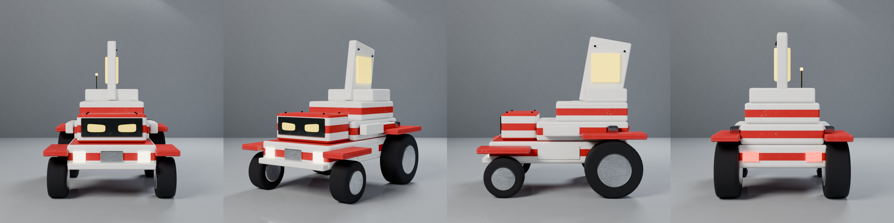

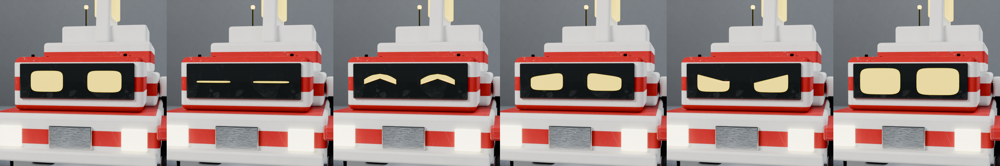

## Primly  ·  The city's head cleaner

**Logic:** "Keep everything clean and in its place."

**In practice:** Primly sweeps streets, straightens crates and stacks things at perfect right angles. Thanks to Primly the city is orderly, safe and easy to find your way through. But it also sweeps fallen leaves and seeds out of the Grove and into the scrap chute, and frowns at Mossback's moss. During the night of the pipe race, its love of straight lines makes it the perfect layer of pipe segments.

**Weak spot:** Primly can't tell a mess from life. Seeds, leaves and moss all look like dirt to it, and it doesn't know that some things belong exactly where they fall.

**Arc:** Early on Primly and Tiny keep crossing paths: Primly sweeps seeds away and Tiny quietly carries them back. Primly and Tiny lock over a single seed, a comic standoff of two small careful robots. During the pipe race Primly's precision is essential. At the root, the pipe has to bend, which horrifies it, until Tiny points out that the bend is exactly where it belongs. At the end Primly sweeps around the fallen leaves in the Grove and leaves them be.

**Voice:** Crisp, prim, mid-pitch, with a soft whisk-brush sound as it moves.

**Build:** 2.1 m tall, wheels, 25 parts, 5 materials. Primly reads as a tall white post on a flat square plate: a slim locker column 1.35 m high with a small square head, flanked by two long rigid arms that end in flat push-broom slabs, so from any distance it is a ruler with two brooms. Every shape is square, centred and symmetric, with crisp bevels, straight trim bands and a neatly lidded dustbin on its back, so its body literally performs its logic of keeping everything at right angles and in its place. The wide low sweeper base with hidden wheels lets it glide in perfectly straight lines, and the grey bristle skirts make even its movement look like tidying. Its palette is near-spotless clean white and pale sky blue with almost no wear or dirt, a cool white eye-light, and tiny safety-yellow lamps that tie it to Gridhaven's street language, which makes it pop sharply against the deep greens and bark browns of the Old Grove it keeps trying to tidy.

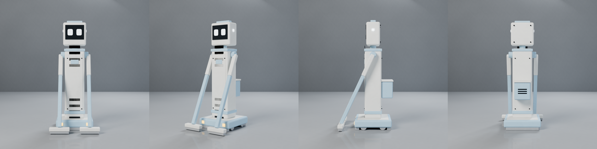

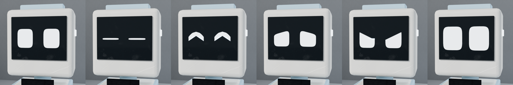
